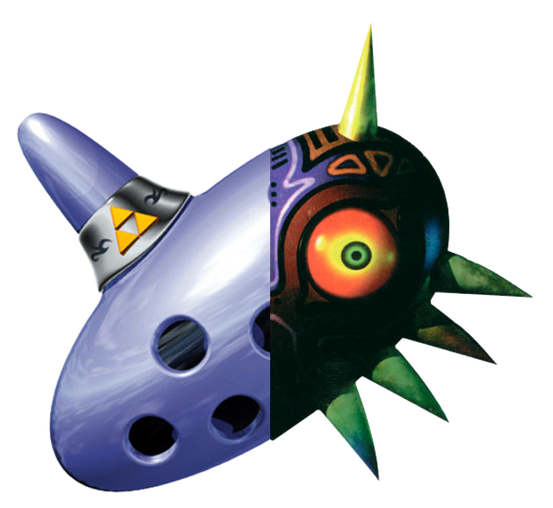

# OoTMM Decrypted

An [Archipelago](https://archipelago.gg) world for the [OoTMM](https://github.com/OoTMM/OoTMM) combo randomizer (The Legend of Zelda: Ocarina of Time and Majora's Mask in one ROM).

It continues Quasky's [AP-OOTMM](https://github.com/Quasky/AP-OOTMM), with its full history. In Archipelago the game is called `OOTxMM`.

## Status

Development build pending a full play session. Archipelago generates with OoTMM v33.0's regions, locations, items and logic, including per-area time ranges. Supported options cover logic, the ROM, check shuffles and dungeon-item, fairy, song and reward placement; other pool changes retain OoTMM's defaults. The host builds each player's patch with the OoTMM toolchain; players apply it with OoTMM v33.0's Patch mode. Assisted BizHawk tests verify real item exchange, cross-game travel, native item counters and both boss goal packets, including server completion across a restart. A complete unmodified play session and wider progression-item coverage remain. [ROADMAP.md](ROADMAP.md) lists what is left.

Start at the [player hub](https://decryptu.github.io/ootmm-decrypted/) for downloads, setup and a starter YAML. The [latest prerelease](https://github.com/Decryptu/ootmm-decrypted/releases/tag/v0.0.1-alpha.3) includes the world package and a prepared two-player playtest. The [setup guide](docs/setup_en.md) covers players and hosts; hub source lives in `site/` and deploys from `main`.

## What you need

- Archipelago 0.6.8, the tested version.
- Your own ROMs: Ocarina of Time 1.0 NTSC-U and Majora's Mask NTSC-U (`.z64`, the versions OoTMM accepts). They are never part of this repository.

## Working on it

[DEVELOPMENT.md](DEVELOPMENT.md) has the layout, tools, ID registries and conventions.

## Credits

- Quasky, for AP-OOTMM, which this repository is built on.
- [Fletch64](https://github.com/Fletch64) and [alphaONE2](https://github.com/alphaONE2), for the first pass at an OoTMM Archipelago world and generator.
- The [OoTMM team](https://github.com/OoTMM/OoTMM), for OoTMM, whose world and settings data this world is generated from.
- The Archipelago contributors.

MIT License, see [LICENSE](LICENSE).
